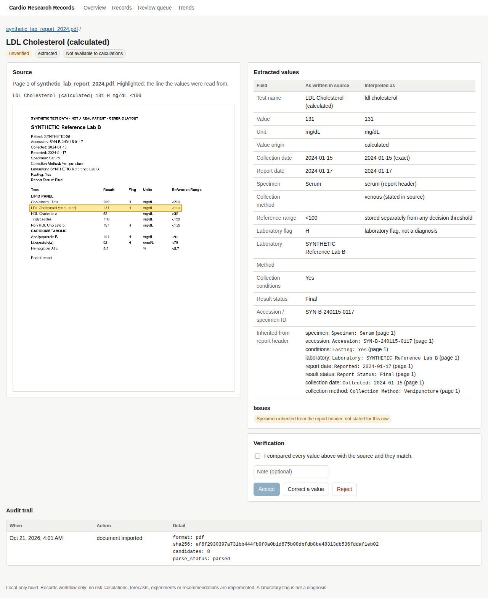
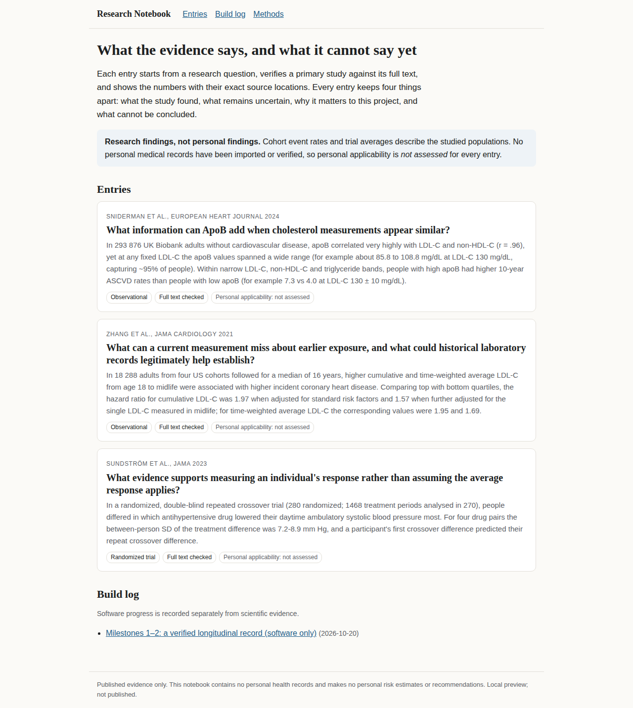

# Personal Cardiovascular Research System

A local-first research partner for one person's cardiovascular health records. It turns lab
reports into a verified longitudinal record, connects that record to primary literature that has
been checked against full text, and runs evidence-linked investigations with a language model
only after the participant approves each individual run.

It is built around a simple rule: **nothing is used until it is verified, and nothing is concluded
that the evidence does not support.** There are no risk scores pretending to be personal, no
forecasts, and no recommendations.



<sub>All screenshots use synthetic fixtures. No real health data is in this repository.</sub>

## What it does

**Verified records**
- Imports CSV and text-layer PDF lab reports. Originals are stored unchanged with a SHA-256.
- Parsing produces *candidates*, never facts. Each candidate is reviewed beside its source
  (PDF page with the line highlighted) and accepted explicitly.
- Corrections supersede, never overwrite. The database refuses in-place edits of values,
  provenance and audit events.
- Unknown stays unknown: dates are never guessed, units are never silently converted, and
  capillary (finger-prick) and venous results form separate series.
- Duplicates, lab corrections and specimen conflicts (for example, an HbA1c reported on serum)
  are flagged and withheld from calculations until resolved.

**Evidence notebook**
- Research entries built from primary studies (Sniderman 2024 on ApoB discordance, Zhang 2021 on
  cumulative LDL-C, Sundström 2023 on individual blood-pressure response, and others), with
  every claim quoted and located in the full text.
- A validator checks the schema and, given a local full-text cache, that every quote actually
  appears in its source. Chart inputs are generated from the claims, not typed by hand.
- Findings, uncertainty, relevance and "what cannot be concluded" are kept as separate fields.

**Research partner**
- Overview by cardiovascular domain (lipids, Lp(a), blood pressure, glucose, kidney,
  inflammation, family history) with explicit statuses. `unknown` is never shown as `normal`.
- Questions over the record and versioned investigations, with retrieval shown.
- Live model runs (Anthropic adapter) require a **per-run, single-use approval** bound to the
  exact payload hash, provider, model and endpoint. The outgoing payload is scoped to the
  observations the investigation depends on, with relative timing instead of dates.
- Every output statement must cite an observation or evidence claim; a citation and scope check
  flags anything uncited, inferred, or outside the rules.
- Predictions are locked before results come in.

**PREVENT**
- An implementation of the AHA PREVENT base equations written from the published coefficients,
  verified against the official corrected supplement, 14 reference cases from the AHA online
  calculator, and a 1,920-case cross-check against the independent `preventr` package.



## Design principles

These are enforced in code and tests, not just stated:

1. **Calculations read only accepted observations,** through a single boundary
   (`services/api/app/calc_inputs.py`).
2. **No personal health data in logs** (`logging_safe.py`, `tests/safety/test_no_health_data_in_logs.py`).
3. **Loopback only.** Every port binds to `127.0.0.1`, the API checks `Host`, origin and a client
   header, and there is deliberately no remote deployment path.
4. **Destructive operations are guarded.** Tests run on disposable Compose projects whose names
   must match a test pattern; the working stack cannot be torn down by a test.
5. **Encrypted, restore-verified backups** before any schema change.
6. **Coding agents never see real values.** Fixes are made against synthetic reproductions of a
   layout, never against the real file in agent context. See `AGENTS.md`.

Decisions are logged with dates and reasons in [`docs/decisions.md`](docs/decisions.md)
(D-001 to D-061). The original brief is [`docs/product-brief.md`](docs/product-brief.md).

## Quick start

Requires Docker Desktop (Compose v2). Nothing else is needed on the host.

```bash
make up                 # web :3000, notebook :3100, API :8000 (all 127.0.0.1)
open http://127.0.0.1:3000
```

Try it with the synthetic fixtures in `fixtures/synthetic/` (regenerate with `make fixtures`).

The app does not encrypt data at rest; use host disk encryption. There is no user
authentication. Do not expose the ports or deploy it remotely.

### Optional: live model provider

See [`docs/live-provider-setup.md`](docs/live-provider-setup.md). The API key is read from a
file mounted read-only into the API container, never from an environment variable or the repo.

## Tests

```bash
make test           # pytest: ingestion, records, safety, risk, research (disposable project)
make e2e            # Playwright: full workflow on an isolated stack with a labelled fake provider
make restore-test   # backup -> destroy volumes -> restore -> identical state
make guard-test     # destructive-operation guards
make check          # all of the above
```

## Repository layout

```
apps/web/                 Next.js + TypeScript records and research interface
apps/notebook/            research notebook (static, renders research/ only)
services/api/             FastAPI, SQLAlchemy, Alembic: parsers, workflow, research runtime, PREVENT
packages/evidence-tools/  evidence schema, validator, chart-input generator
packages/schemas/         exported OpenAPI contract
research/                 evidence records, research questions, chart inputs
fixtures/synthetic/       synthetic fixtures and their generator
tests/                    pytest suites and Playwright end-to-end tests
docs/                     brief, architecture, safety boundaries, validation plan, decisions
scripts/                  backup, restore, e2e and guard runners
```

## Status

A personal project, built for one participant. See [`docs/current-state.md`](docs/current-state.md).

## Not medical advice

This software organizes records and published evidence. It does not diagnose, prescribe, order
tests, or estimate personal risk, and it is not a medical device. Laboratory flags are shown as
"laboratory flag, not a diagnosis". Talk to a clinician about your health.

AHA distributes its own PREVENT source code under a license; that code is not used here. This
implementation is written from the published equations, and whether commercial use of PREVENT
requires a license is unresolved.

## License

MIT. See [`LICENSE`](LICENSE).
